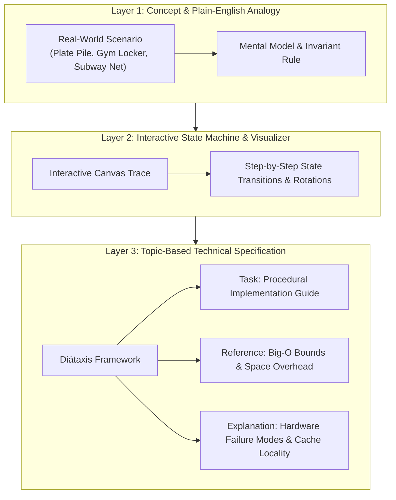

# AlgoDocs-Interactive 📚⚡
### Interactive Technical Documentation & Concept Visualizer Engine

[](https://nextjs.org/)
[](https://www.typescriptlang.org/)
[](https://algodocs-interactive.vercel.app)
[](#diátaxis-documentation-standard)
[](https://microsoft.github.io/monaco-editor/)
[](https://tailwindcss.com/)
[](LICENSE)

**AlgoDocs-Interactive** is an interactive technical documentation platform built to demonstrate **technical writing craft**, **concept simplification**, and **developer-centric communication**.

> 🌐 **Live Production Deployment**: [https://algodocs-interactive.vercel.app](https://algodocs-interactive.vercel.app)  
> 📦 **GitHub Repository**: [https://github.com/AtharvaDhobale/AlgoDocs-Interactive](https://github.com/AtharvaDhobale/AlgoDocs-Interactive)

Built to answer the core mandate:  
> *"A strong writer who understands technology and is excited about Gen AI, rather than a strong coder who happens to be able to write."*

AlgoDocs-Interactive bridges abstract computer science algorithms and human understanding by pairing **real-life analogies** with **live step-by-step state traces**, **interactive code execution**, and **topic-based documentation** structured around the industry-standard **Diátaxis framework**.

---

## 🎯 The Technical Writing Challenge

Software products and distributed computing systems (e.g., enterprise storage engines, snapshot trees, deduplication algorithms) are inherently complex. When documentation is written solely by engineers, it frequently suffers from:
1. **The Curse of Knowledge**: Overuse of dense jargon that alienates non-specialist or junior stakeholders.
2. **Missing Mental Invariants**: Describing *what* code does line-by-line without giving the reader a tangible mental model.
3. **One-Size-Fits-None Writing**: Failing to adjust technical depth for differing customer personas.

**AlgoDocs-Interactive solves this through a three-layer documentation architecture:**



---

## ✨ Key Features & Capabilities

### 1. 📖 Diátaxis Topic-Based Documentation Spec
Every data structure features a comprehensive, embedded technical documentation specification:
- **Concept**: Architectural overview and core invariant definition.
- **Task Procedure**: Numbered step-by-step implementation guide written in active, imperative voice.
- **Reference Table**: Rigorous time complexity bounds (*Index Access, Search, Insertion, Deletion*) and space overhead.
- **Failure Modes & Pitfalls**: Explicit warnings for edge cases, stack overflows, pointer corruption, and hash collision clustering.

### 2. 🎛️ Three-Tier Audience Reading Level Switcher
Readers can toggle between three tailored depth perspectives on every topic:
- 🟢 **Plain-English (Customer / Beginner)**: Clear analogies and physical metaphors for non-technical audiences.
- 🔵 **Developer Guide (Software Engineer)**: API contracts, algorithmic trade-offs, and invariant verification.
- 🟣 **Systems Architect (Senior Staff)**: CPU cache-line alignment, pointer-chasing overhead, branch prediction, and memory layout.

### 3. 🍽️ Real-Life Analogy Engine
Translates abstract mathematical concepts into concrete physical systems:

| Data Structure | Plain-English Analogy | Computing Principle Illustrated |
| :--- | :--- | :--- |
| **Stack** | 🍽️ Cafeteria Plate Stack | **LIFO** (Last In, First Out) & Call-Stack evaluation. |
| **Queue & Deque** | 🎢 Water Park Slide Line | **FIFO** (First In, First Out) & Fair Scheduling buffers. |
| **Linked List** | 🗺️ Treasure Hunt Clue Chain | **Pointer Indirection** & Non-contiguous dynamic memory. |
| **Binary Search Tree** | 📖 Sorted Phonebook | **Binary Partitioning** & Logarithmic search spaces. |
| **AVL Tree** | ⚖️ Self-Balancing Mobile | **Rotation Invariants** (LL, RR, LR, RL) preventing $O(N)$ degradation. |
| **Hash Table** | 🔐 Assigned Gym Lockers | **Hash Functions & Collision Chaining** via modular arithmetic. |
| **Graph** | 🚇 Metro Rail Transit Network | **Nodes & Edges** with BFS (breadth scan) & DFS (deep explore). |

### 4. 💻 Interactive Code Playground (Monaco Editor)
- Built-in multi-language editor (TypeScript, JavaScript, Python, Java, C++).
- 365+ curated coding and algorithm problems with hints and topic tags.
- Line-by-line step debugger.

---

## 📂 Docs-as-Code Directory Architecture

The repository enforces structured documentation standards:

```
AlgoDocs-Interactive/
├── docs/
│   ├── STYLE_GUIDE.md          # Technical writing style guide & analogy calibration
│   ├── api/                    # REST API specifications and endpoint schemas
│   ├── architecture/           # High-level component architecture and data flows
│   ├── database/               # Relational entity-relationship specifications (ERD)
│   ├── deployment/             # Docker containerization and cloud hosting runbooks
│   └── modules/                # Deep-dive modular functional specifications
├── frontend/
│   ├── src/
│   │   ├── app/
│   │   │   ├── page.tsx        # Conceptual landing page
│   │   │   ├── visualizer/     # Interactive visualizer + TopicDocsSpec studio
│   │   │   └── practice/       # Monaco IDE code editor & problem solver
│   │   └── components/
│   │       └── TopicDocsSpec.tsx # Multi-audience Diátaxis documentation component
│   └── package.json
└── README.md
```

---

## ⚡ Quickstart & Local Setup

### Prerequisites
- Node.js 18+ and npm

### Running the Frontend
```bash
cd frontend
npm install
npm run dev
```
Open **`http://localhost:3002`** (or `http://localhost:3000`) in your browser to launch the interactive platform.

---

## 🛠️ Tech Stack

- **Framework**: Next.js 15 (App Router), React 19, TypeScript.
- **Editor**: Monaco Editor (`@monaco-editor/react`).
- **Styling**: Tailwind CSS v4, Lucide React Icons.
- **Visualization**: Custom SVG & Canvas rendering engines with dynamic rotation traces.
- **Documentation Standards**: Diátaxis Framework, DITA, Docs-as-Code.

---

## 👤 Author

**Atharva Dhobale**  
- **GitHub**: [@AtharvaDhobale](https://github.com/AtharvaDhobale)  
- **Focus**: Technical Product Documentation, GenAI Tooling, Interactive Developer Portals.

Licensed under the [MIT License](LICENSE).