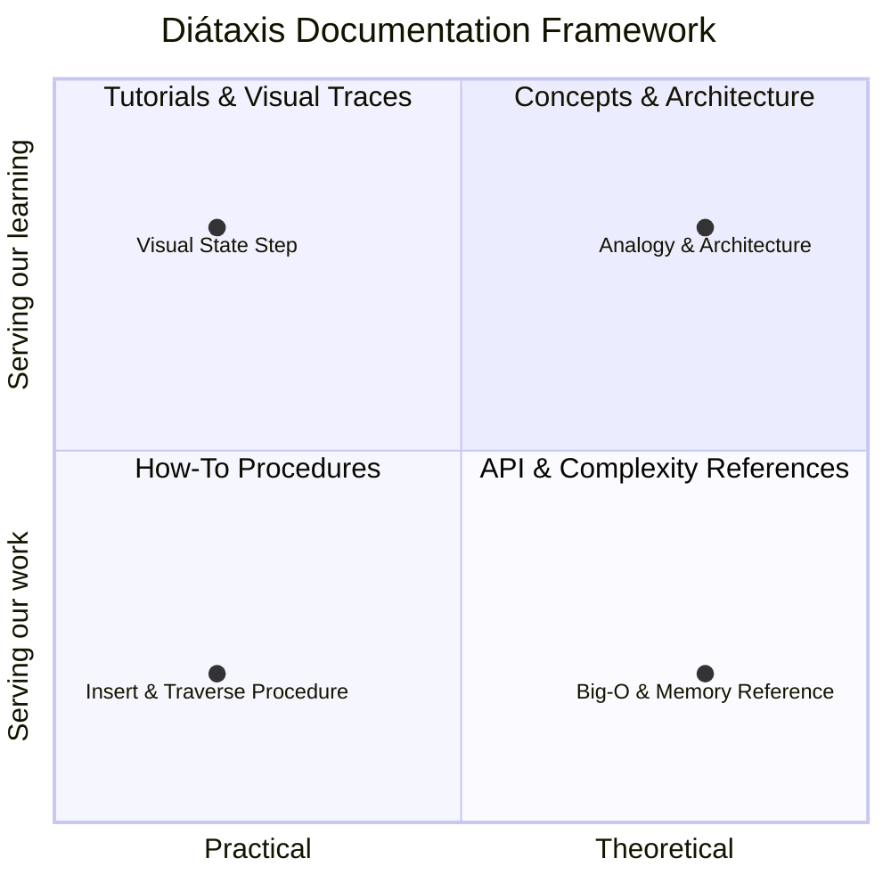

# AlgoDocs-Interactive Technical Documentation & Concept Craft Guide

This guide establishes the editorial style, topic-based authoring taxonomy, and plain-English analogy frameworks used across **AlgoDocs-Interactive**.

---

## 1. Editorial Mission: Customer-Centric Simplification

> *"A strong writer who understands technology and is excited about Gen AI, rather than a strong coder who happens to be able to write."*

Our goal is to make computing fundamentals crystal clear for three distinct audiences without dumbing down technical accuracy:
- **Audience Tier 1 (Non-Technical / Learners)**: Relies on concrete real-world metaphors (plates, lockers, subway lines) to build mental models.
- **Audience Tier 2 (Software Engineers)**: Focuses on API contracts, invariants, and step-by-step procedure sequences.
- **Audience Tier 3 (Systems Architects)**: Analyzes memory layouts, cache locality (L1/L2/L3), pointer chasing, and worst-case bounds.

---

## 2. Diátaxis Framework Implementation

Every algorithm and data structure topic must strictly follow the 4 Diátaxis archetypes:

### I. Concept (Understanding-Oriented)
- **Plain-English Analogy**: Connect the abstract data structure to an everyday physical object or scenario.
- **Mental Invariant**: The single rule that governs the structure (e.g., LIFO for stacks, BST invariant for trees).

### II. Task / How-To (Action-Oriented)
- Active imperative verbs: `"Insert the element at the head"`, `"Traverse left subtree"`.
- Explicit preconditions (e.g. check capacity before pushing to avoid overflow).
- Verifiable expected result at every step.

### III. Reference (Information-Oriented)
- Time complexity matrix (Access, Search, Insert, Delete for Average and Worst cases).
- Space complexity ($O(N)$ overhead and pointer metadata costs).

### IV. Explanation / Failure Modes (Problem-Oriented)
- Address failure modes: stack overflow, memory fragmentation, degenerate tree skewness, hash collision clustering.

---

## 3. Approved Analogy Calibration

| Data Structure | Approved Analogy | Rationale |
| :--- | :--- | :--- |
| **Stack** | Cafeteria Plate Pile | Clearly illustrates LIFO: you cannot take from the bottom without lifting the top. |
| **Queue** | Water Park Slide Queue | Illustrates FIFO and fairness: first to arrive is the first to ride. |
| **Linked List** | Treasure Hunt Trail | Illustrates pointer indirection: each chest holds the clue to the next. |
| **Binary Search Tree** | Sorted Phonebook | Illustrates binary partitioning: divide remaining options in half each step. |
| **Hash Table** | Assigned Gym Lockers | Illustrates key-to-index mapping and bucket collision chaining. |
| **Graph** | Metro Rail Transit Network | Illustrates nodes (stations) and edges (rail lines) with BFS/DFS pathfinding. |

---

## 4. Documentation Quality Checklist
Before publishing a topic or guide:
- [ ] Analogy verified for zero technical misrepresentation.
- [ ] Active voice used for all procedural steps.
- [ ] Big-O time and space bounds verified.
- [ ] Edge cases (empty collection, single item, overflow) documented.
- [ ] Code snippets formatted in Markdown with syntax highlighting.
