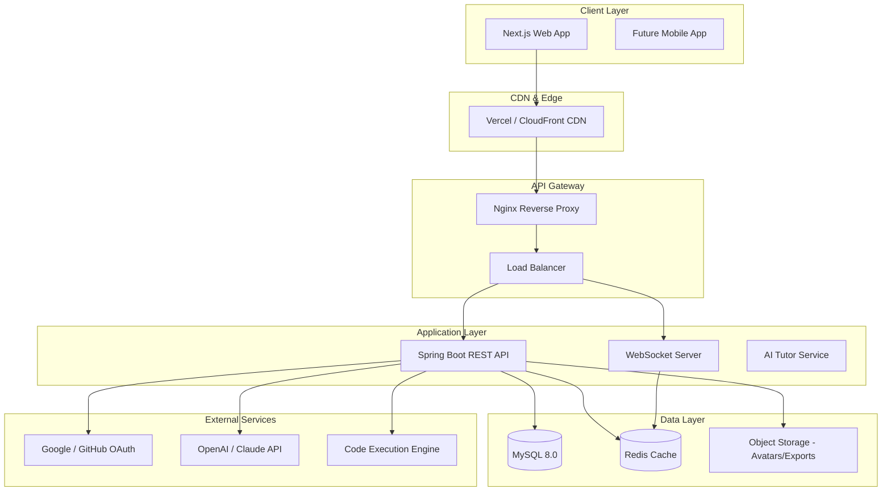
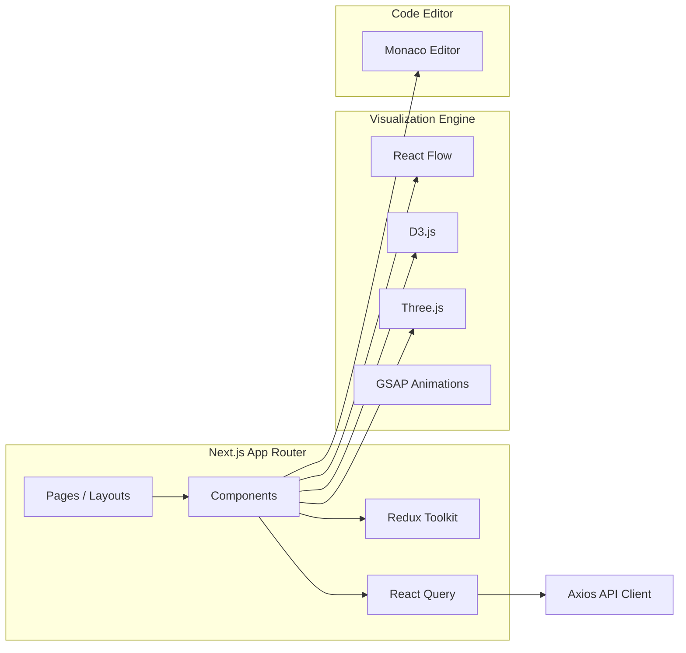
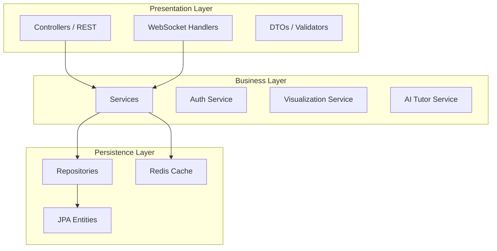
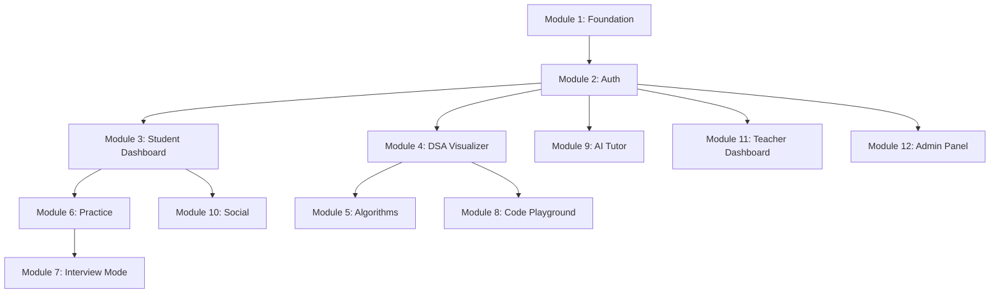

# AlgoVision AI — System Architecture

## High-Level Architecture

## Frontend Architecture

## Backend Architecture (Layered / Clean)

## Security Architecture

| Layer | Mechanism |
|-------|-----------|
| Authentication | JWT (Access + Refresh tokens) |
| Authorization | Role-Based Access Control (RBAC) |
| API Security | CORS, Rate Limiting, Input Validation |
| Data | BCrypt password hashing, encrypted 2FA secrets |
| Session | Redis-backed token blacklist |

## Role-Based Access Matrix

| Resource | Student | Teacher | Recruiter | Admin |
|----------|---------|---------|-----------|-------|
| Visualizations | CRUD own | Read all | — | CRUD all |
| Practice Problems | Solve | Assign | — | CRUD |
| AI Tutor | Use | Use | — | Configure |
| Analytics | Own | Class | Candidates | Platform |
| User Management | Profile | Students | — | Full |

## Module Dependency Graph

## Technology Decisions

### Why Next.js 16?
- App Router for nested layouts (role-based dashboards)
- Server Components for SEO on landing/marketing pages
- Built-in API routes for BFF pattern if needed

### Why Spring Boot?
- Enterprise-grade security (Spring Security)
- Mature JPA/Hibernate ORM
- WebSocket support for real-time collaboration
- Excellent testing ecosystem (JUnit, MockMvc)

### Why Redis?
- Session/token caching
- Leaderboard real-time updates
- Rate limiting counters
- WebSocket pub/sub for collaboration

## Non-Functional Requirements

| Requirement | Implementation |
|-------------|----------------|
| Performance | Redis caching, lazy loading, code splitting |
| Scalability | Stateless API, horizontal scaling |
| Security | JWT, RBAC, HTTPS, input sanitization |
| Accessibility | WCAG 2.1 AA, keyboard navigation |
| SEO | SSR landing pages, meta tags, sitemap |
| Monitoring | Spring Actuator, health checks |
