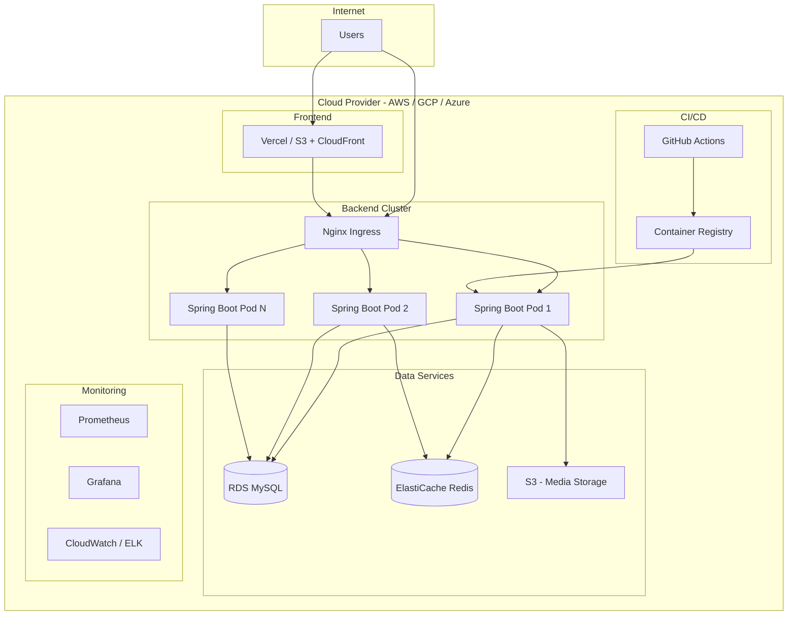

# Deployment Architecture

## Production Deployment



## Docker Compose (Local Development)

| Service | Port | Image |
|---------|------|-------|
| frontend | 3000 | node:22-alpine |
| backend | 8080 | eclipse-temurin:21 |
| mysql | 3306 | mysql:8.0 |
| redis | 6379 | redis:7-alpine |

## Environment Variables

### Frontend (.env.local)
```
NEXT_PUBLIC_API_URL=http://localhost:8080/api/v1
NEXT_PUBLIC_WS_URL=ws://localhost:8080/ws
```

### Backend (application.yml)
```
SPRING_DATASOURCE_URL=jdbc:mysql://mysql:3306/algovision_db
SPRING_REDIS_HOST=redis
JWT_SECRET=<256-bit-secret>
JWT_EXPIRATION=86400000
```

## Deployment Steps

1. **Build**: `docker compose build`
2. **Migrate**: Run `database/schema.sql` against MySQL
3. **Deploy**: `docker compose up -d`
4. **Verify**: Health check at `/actuator/health`

## Scaling Strategy

- **Horizontal**: Add Spring Boot replicas behind load balancer
- **Database**: Read replicas for analytics queries
- **Cache**: Redis cluster for session/leaderboard
- **CDN**: Static assets and visualization exports
